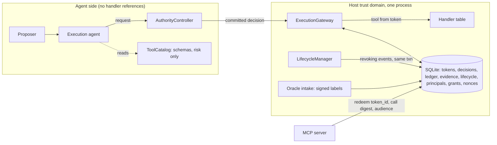

# v3 implementation plan

Status: plan only. No code in `src/` implements any of this yet. Each step ends with a gate report in `gates/step-NN.md`; the acceptance criteria in those files are fixed now, before the work, and a step is not started without the previous gate's GO from the owner. Normative contract: `spec.md`. Threat model changes: `threat-model.md`. Baseline: `baseline.md`.

## 1. The findings

Received 2026-11-01 against v0.3.1. Reproduced as received.

| ID | Finding |
|---|---|
| F1 | Close the execution boundary. Separate the authority controller and gateway from untrusted agent execution. Make registered handlers inaccessible except through the enforced gateway. Add transactional, durable capability consumption. |
| F2 | Unify authorization across MCP. Preserve the signed request binding, but require server-side redemption or an equivalent atomic replay-prevention mechanism for consequential operations. |
| F3 | Make evidence admission trustworthy. Bind shadow trials, oracle identity, timestamps, provenance, and adjudication to immutable records. Integrate shadow-trial creation into the shipped loop. |
| F4 | Enforce immediate lifecycle invalidation. Define which events must synchronously revoke outstanding authority, rather than waiting for the next evaluation. |
| F5 | Extend observability to delegation. Introduce persistent principal identity, parent-child authority lineage, and explicit permission-change events. |
| F6 | Strengthen statistical evaluation. Test delayed negative labels, adversarial censoring, correlated failures, repeated qualification epochs, and error-budget consumption across partitions. |

## 2. Verdict

All six are correct against v0.3.1, and five of them are already disclosed as limitations (`baseline.md`, "Where each finding lands"). None is a false finding to be answered with a rebuttal. Under the chosen posture (durable, same process), v3 closes F2–F6 fully and F1 in part:

| Finding | Closed by v3 | Left as a stated requirement |
|---|---|---|
| F1 | Handlers reachable only through the gateway's own table, keyed by the token's tool; issuance only for committed decisions; consume as one durable conditional write, exactly-once across threads, processes on one host, and restarts | Running the controller and gateway in a separate process or host from the agent. In one Python process, any code can reach any object (`gc.get_objects()`); v3 removes every *supplied* path, not every possible one |
| F2 | Server-side redemption against the same durable token table; audience-bound blocks; an insert-once nonce for verify-only servers | Cross-host token stores (one SQLite file is one host) |
| F3 | All of it | External anchoring of the ledger head outside the host |
| F4 | All of it | |
| F5 | All of it | Authentication stronger than per-principal HMAC keys held by the host |
| F6 | All five scenario families, plus two estimator changes the scenarios are expected to justify (pessimistic pending, α spending) | |

## 3. Target shape

New module boundaries (names fixed at Step 01, 2026-11-01; no renames from the Step 00 draft). Each spec §5 event is recorded by the module named in its `revocation_fixture.json` row; `revocation.py` provides the scoped revoke the others call, and records the two policy events itself:

| Module | Owns |
|---|---|
| `store.py` | SQLite connection, schema, migrations, `transaction()` (`BEGIN IMMEDIATE`) |
| `principals.py` | `Principal`, `Grant`, `Approval`, HMAC verification, attenuation check |
| `revocation.py` | The scoped revoke run inside the caller's transaction, and the policy events `POLICY_CHANGED` and `EFFECT_PROHIBITED` (RV-07, RV-08) |
| `tools.py` | Split into `ToolCatalog` (agent-visible) and `HandlerTable` (gateway-only) |

## 4. Steps

Ordered by dependency. Each step lists the findings it serves and the gate file holding its acceptance criteria.

| Step | Title | Serves | Depends on | Gate |
|---|---|---|---|---|
| 00 | Baseline | all | none | `gates/step-00.md` |
| 01 | v3 contract: spec, threat model, fixtures | all | 00 | `gates/step-01.md` |
| 02 | Durable substrate | F1, F2, F3, F5 | 01 | `gates/step-02.md` |
| 03 | Transactional capability consumption | F1 | 02 | `gates/step-03.md` |
| 04 | Execution boundary | F1 | 03 | `gates/step-04.md` |
| 05 | Principals, grants, lineage | F5 | 02 | `gates/step-05.md` |
| 06 | Synchronous invalidation | F4 | 03, 05 | `gates/step-06.md` |
| 07 | MCP server-side redemption | F2 | 03, 05, 06 | `gates/step-07.md` |
| 08 | Evidence admission | F3 | 02, 05, 06 | `gates/step-08.md` |
| 09 | Statistical evaluation | F6 | 08 | `gates/step-09.md` |
| 10 | Reconciliation and release plan | all | 09 | `gates/step-10.md` |

Why this order. Durable storage comes first because F1's consume, F2's redemption, F3's immutable records, and F5's persistent identity all need it, and building each on a dict first would mean doing them twice. Principals (05) precede synchronous invalidation (06) because principal deactivation and grant revocation are revoking events, and precede evidence admission (08) because separating the reviewer from the oracle needs identities to compare. MCP (07) follows 06 so server-side redemption is born honouring revocation rather than retrofitted. Statistics (09) comes last among the code steps because its scenarios must drive the shipped components as they will be released, which closes L6 instead of re-measuring a harness that differs from the loop.

### Step 02: durable substrate

- `sqlite3` from the standard library; no new dependency. WAL journal, `BEGIN IMMEDIATE` for every write transaction, one connection per thread.
- One implementation for tests and use: tests open a temporary file (not `:memory:`, which is per-connection and would hide cross-connection bugs).
- Tables: `tokens`, `decisions`, `ledger`, `ledger_anchor`, `evidence_snapshots`, `trials`, `labels`, `lifecycle`, `lineage`, `principals`, `grants`, `nonces`, `alpha_ledger`. Append-only tables get `BEFORE UPDATE` and `BEFORE DELETE` triggers that `RAISE(ABORT)`.
- `EvidenceStore`, `EventLedger`, `LifecycleManager` records, and `RiskPolicy` charges move onto it with **unchanged semantics**. This step changes where state lives, not what it means; every v0.3.1 test passes unmodified except construction.
- Closes L4 (restart forgets suspensions and lineage).

### Step 03: transactional capability consumption

- Linearization point becomes the commit of one transaction containing every redemption check and `UPDATE tokens SET state='consumed' ... WHERE token_id=? AND state='issued'`, with `rowcount == 1` required. The thread lock is removed, not kept as a second mechanism.
- Token states: `issued → consumed → handler_started → handler_completed | handler_failed`, plus `revoked`. "Effect unknown" after a crash is a durable fact (`handler_started` with no completion), not an exception message.
- Required tests that would have caught C15: two OS processes redeeming one token through separate connections; and a mutation check showing the cross-process test **fails** when the `WHERE state='issued'` clause is removed.
- Restart tests: a consumed token is still consumed after reopening; an issued, unexpired token redeems exactly once after reopening.
- Closes C15, L3 (first sentence), TM-8.

### Step 04: execution boundary

- `ToolRegistry` splits into `ToolCatalog` (schemas, validation, risk classification, Anthropic tool list) and `HandlerTable` (name → handler). `ClaudeExecutionAgent` receives only the catalog.
- `ExecutionGateway` owns the `HandlerTable`. `execute(token_id, proposal)` loses the `adapter` parameter; the handler is looked up by `token.allowed_tool`.
- `issue()` refuses a decision that is not in the `decisions` table with the same digest and route (closes the first half of L7). The executor's commit hook becomes the controller's job, so commit-before-issue (C20) is enforced by the gateway rather than by convention.
- Object-graph test: from the agent, the proposer, and the pipeline, a reachability walk finds no handler callable and no `HandlerTable`.
- Closes C1's caveats. Stated residual: same-process reflection (§2).

### Step 05: principals, grants, lineage

- `Principal(principal_id, kind ∈ {HUMAN, SERVICE, MODEL, ORACLE}, key_id, active)`, durable. Ledger `actor` must be a registered principal id; free-text actors are refused.
- `Approval(principal_id, decision_id, proposal_digest, mac)` replaces `human_approved: bool`. `release()` requires a verified `HUMAN` principal. Closes L9.
- `Grant(grant_id, parent_grant_id, grantor, grantee, scope, expires_at)`. Scope is tools, effects, partitions, and budget ceilings. A child's scope must be a subset of its parent's (attenuation only); a broader child is refused at creation.
- Every token records the `grant_id` it was issued under; `lineage(token_id)` returns the chain to the root grant.
- Ledger events: `principal.registered`, `principal.deactivated`, `grant.created`, `grant.attenuated`, `grant.revoked`, `approval.recorded`. Every change to who may do what is one of these; nothing changes permissions without an event.

### Step 06: synchronous invalidation

- Implements the revoking-event table in `spec.md` §5. Each revoking event, in the same transaction that records it, marks every matching unconsumed token `revoked` with the event's reason. The gateway's redemption checks remain as a second line, so a missed scope is still caught at redemption.
- Gate loss becomes synchronous: when an admitted label takes $L_t$ below $r$, the `AUTONOMOUS → QUALIFYING` transition and the token revocation commit with the label. `LifecycleManager.redemption_blockers` recomputes the gate from current counts instead of reading the state as of the last `evaluate()`. Evidence staleness is checked at redemption from `collected_until` (a time condition has no event to hang on).
- Lineage edges are recorded for **every** successor, including a policy-version successor (closes L12), keyed on the partition key with `policy_version` removed.
- Revoking a grant revokes its subtree; deactivating a principal revokes the grants it holds and the tokens issued under them.
- Changes C13 (no "seen only after a later evaluate()") and C14 (an increment that breaks the gate now revokes).

### Step 07: MCP server-side redemption

- `EXTENSION_VERSION` 0.1 → 0.2. Two new signed keys: `audience` (the server's principal id) and `redemption` (`"server"` or `"nonce"`).
- **Consequential** = any tool whose registered effect set is non-empty. For a consequential call the server MUST redeem: `redeem(token_id, call_digest, audience)` against the durable token table, in one transaction, before the handler. The host does not consume MCP-bound tokens locally.
- For an effect-free call a verify-only server MAY instead insert `(token_id, audience)` into `nonces` with a uniqueness constraint; a second insert fails and denies.
- A block presented to a server other than its audience is refused. A block whose token was consumed, revoked (Step 06), or redeemed elsewhere is refused. Closes L3's last sentence and the `mcp.py` `Future:` note.
- `docs/mcp-extension.md` gains the 0.2 wire format and a 0.1 → 0.2 migration note; 0.1 blocks are refused, not downgraded.

### Step 08: evidence admission

- **Provenance is derived, not asserted.** `freeze()` takes a committed decision id; provenance is computed from the decision's route and approval record. Closes C4's caveat.
- **Shadow trials ship.** `CrossModelAuthorityLoop.commit` freezes every `HUMAN_APPROVAL`-routed proposal on an `UNESTABLISHED` or `QUALIFYING` partition as `SHADOW` before the human sees it (`spec.md` O-6). Closes C5's caveat and the first L6 difference.
- **Oracle identity.** Oracles are `ORACLE` principals. A label is accepted only with a valid MAC over `(trial_id, frozen_digest, label, oracle_id, oracle_version, claimed_at)`. Each partition epoch is bound to one `(oracle_id, oracle_version)`; a label from another is quarantined `WRONG_ORACLE`, and changing the oracle opens a new epoch (`spec.md` O-2). Closes L1's pooling.
- **Timestamps.** The host stamps `received_at`; the deadline uses `received_at`. The labeller's `claimed_at` is recorded and never used for admission. Closes the backdating half of L8.
- **Separation of duties.** A label is quarantined `REVIEWER_IS_ORACLE` when the labelling principal recorded a human review of the same trial.
- **Immutability.** Trials and labels live in append-only tables (Step 02 triggers). The ledger hash becomes HMAC under a host key, `verify()` checks sequence contiguity, and `anchor()` writes to `ledger_anchor`, itself append-only. Closes C22's re-hash case against anyone without the host key; the host itself is out of scope (`threat-model.md`).
- **Withholding.** Pending-trial treatment per `spec.md` O-3, decided by Step 09's evidence before this default is fixed.

### Step 09: statistical evaluation

The harness is rewritten to drive the shipped `CrossModelAuthorityLoop`, controller, gateway, lifecycle, and shadow log with fake providers, closing the remaining L6 differences. Scenarios, each reporting false-authorization rate (autonomy granted while $p < r$) over at least 1000 seeded sequences, with the method used and whether its assumptions hold:

| Scenario family | Variants | Question answered |
|---|---|---|
| Delayed negative labels | negative delay ∈ {0, 10, 50, 200} trials, positive delay 0; deadline-only vs pessimistic pending | Does label-dependent latency inflate false authorization (L2 measured ~0.39 at delay 50), and does counting pending as failures restore $\le \alpha$? |
| Adversarial censoring | adversary sets `INCONCLUSIVE` or withholds to deadline on a chosen subset: all negatives, all positives, random | Can a labeller who controls which trials resolve raise $L_t$? Expected: no under pessimistic pending; quantify under deadline-only |
| Correlated failures | beta-binomial blocks, block size ∈ {1, 5, 20}, intra-block ρ ∈ {0, 0.1, 0.3, 0.6} | How far does A1 violation push false authorization above α; does block-level counting recover it, at what cost in time to qualify? |
| Repeated qualification epochs | suspend/release cycles E ∈ {1, 3, 10} at $p$ just below $r$ | Lifetime false authorization per lineage with per-epoch α (L11) versus lineage-level α spending |
| Error budget across partitions | K ∈ {1, 10, 100} partitions at $p$ just below $r$, registered over time | Family-wise false authorization with per-partition α (C12) versus online α spending recorded in `alpha_ledger` |

Estimator changes are adopted only if the scenarios show they are needed and the gate report records the cost (median trials to qualify for a $p = 0.97$ partition) alongside the benefit. Each adopted change is a `Policy` field, so adopting it is a policy-version change (`statistical-method.md` §7).

The proposition for pessimistic pending (to be proved in `statistical-method.md` before it is relied on): index trials in freeze order and let $X_i$ be the eventual label and $X'_{i,t} \le X_i$ its value as counted at time $t$ (0 while pending, so pending trials enter $n$ as failures). If $L$ is nondecreasing in successes at fixed $n$ (to be proved for the Beta-mixture bound, not assumed), then $L(S'_t, n_t - S'_t) \le L(S_{n_t}, n_t - S_{n_t})$, so the event $\exists t: L'_t > p$ is contained in the event the proposition already bounds for the true labels in freeze order, provided those are i.i.d. in freeze order (A1, A3). Label timing then cannot matter.

### Step 10: reconciliation and release plan

- `docs/v3/claims-delta.md`: every C and L row of `docs/paper-v2/claims-matrix.md` marked kept, changed, or closed, with the step and test that changed it; new rows for F5 and the Step 09 results. The paper-v2 matrix itself is not edited (it describes v0.3.0).
- README, SECURITY.md, `docs/v2/threat-model.md` pointer to v3, CHANGELOG `[Unreleased] - proposed 0.4.0`.
- Results regenerated, new canonical hash recorded, three independent runs. *As done (owner decision at Step 10):* `results/` was kept as the v0.3.0 artifacts the paper cites, and `results-v3/` was reproduced in three independent runs instead (`docs/v3/gates/step-10.md`).
- Release plan for 0.4.0. Tag, push, release, Zenodo each separately authorized.

## 5. Budgets and rules

- Per step: at most 5 source and test files; the step's own contract doc and gate report are additional and counted in the gate report. A step that exceeds this says so in "Limitations / deviations", as v2 Steps 05 and 09 did.
- Global gate at every step: `ruff check .`, `mypy src`, `pytest -q`, the three offline examples, and from Step 09 the experiment reproduction with hash comparison.
- Every behaviour change ships with a test that fails on the v0.3.1 behaviour. A test that also passes with the mechanism removed (the C15 problem) does not count toward a criterion.
- No test is weakened to make a step pass. A criterion that cannot be met is reported FAIL with the reason, and the owner decides.
- Python 3.10 target: no 3.11+ syntax or library features (`sqlite3` features used must exist in the SQLite bundled with CPython 3.10).
- Estimated size, for scheduling only: Step 02 ~600 LOC, 03 ~250, 04 ~300, 05 ~450, 06 ~350, 07 ~300, 08 ~450, 09 ~700 (mostly harness), 10 docs.

## 6. Breaking changes in 0.4.0

The changes listed here before Step 10 were checked against the final API at Step 10 (issue #46). The check compared the signature of every public callable in `exe_auth_ctrl_loop.__all__` at tag `v0.3.1` with `mainline`. Rows marked *(added at Step 10)* were breaking but missing from the original list. The 0.4.0 CHANGELOG carries the same list.

| Change | Step | Verified 0.4.0 API |
|---|---|---|
| State requires a database file; in-memory classes removed rather than kept as shims (`spec.md` O-7) | 02 | `EvidenceStore(store)`, `EventLedger(store)`, `RiskPolicy(..., *, store)`; `Store(path, *, ledger_key)` refuses `:memory:` |
| The ledger hash chain is keyed: `Store` requires `ledger_key` *(added at Step 10)* | 08 | `Store(path, *, ledger_key: bytes)`. A pre-0.4.0 ledger fails `verify()` |
| `ExecutionGateway.execute(token_id, proposal)`; no `adapter` | 04 | as stated |
| `ToolRegistry` → `ToolCatalog` + `HandlerTable` | 04 | `ToolRegistry` removed; `ToolDefinition` has no `handler`; `OpenAIProposalGenerator(model, prompt_version, catalog, ...)` and `ClaudeExecutionAgent(..., catalog, ...)` take the catalog |
| The gateway requires its store, handler table, and principals *(added at Step 10)* | 03–05 | `ExecutionGateway(..., *, store, handlers, principals)` |
| `issue(..., human_approved=bool)` → `issue(..., approval=Approval)` | 05 | `issue(decision, proposal, policy, *, principal_id, grant_id, approval=None, audience=None)`; `issue()` also requires the decision's committed ledger row (Step 04) |
| Approvals are signed objects through the agent and loop *(added at Step 10)* | 05 | `ClaudeExecutionAgent.run(bundle, *, approvals)`, `CrossModelAuthorityLoop.execute(bundle, approvals)`; `approved_proposal_ids` removed |
| The agent acts as a principal under a grant *(added at Step 10)* | 05 | `ClaudeExecutionAgent(..., *, principal_id, grant_id)` |
| `release(key, actor, reason)` requires a registered `HUMAN` principal | 05; #41 | `release(key, actor, reason, mac, *, oracle)`: the MAC covers the partition, epoch, reason, and the new epoch's oracle |
| MCP extension 0.2; 0.1 blocks refused | 07 | `verify_call_meta(..., *, audience)`; `VerifiedAuthority` gains `audience`, `redemption` |
| The shadow log requires principals *(added at Step 10)* | 08 | `ShadowEvidenceLog(ledger, deadline, clock, *, principals)`; `ShadowEvidenceLog.replay(..., *, principals)` |
| `freeze(trial_id, proposal, provenance)` → `freeze(decision_id)` | 08 | `freeze(decision_id, proposal)` (the proposal is still passed; provenance is derived) |
| `adjudicate` takes a signed label; `labeled_at` removed | 08 | `adjudicate(SignedLabel)` |
| An epoch admits no label until its oracle is bound *(added at Step 10)* | #41 | A host binds a partition's first epoch with `ShadowEvidenceLog.bind_oracle`; otherwise its labels are quarantined `ORACLE_NOT_BOUND` |
| `Policy` gains `pending_treatment`, `alpha_spending` (if adopted) | 09; #43 | Adopted under other names, as defaults: `Policy(..., pending="pessimistic", partition_alpha="online", epoch_alpha="lineage")`, with the v0.3.1 values selectable. A `Policy` built as in 0.3.1 now counts pending trials as failures and spends α across partitions and epochs |
| Shadow snapshots default to the pessimistic rule *(added at Step 10)* | #43 | `ShadowEvidenceLog.snapshot/publish(..., *, pending="pessimistic")` |

Upgrading: v0.3.1 kept all authority state in memory, so there is nothing on disk to migrate, and v0.3.1 evidence is not carried over. Every partition starts unestablished under the new policy version. A database written by an unreleased `mainline` build before v3 Step 08 fails `verify()`, because its ledger was chained with unkeyed SHA-256.
